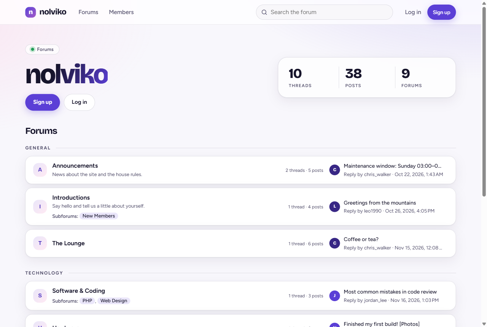
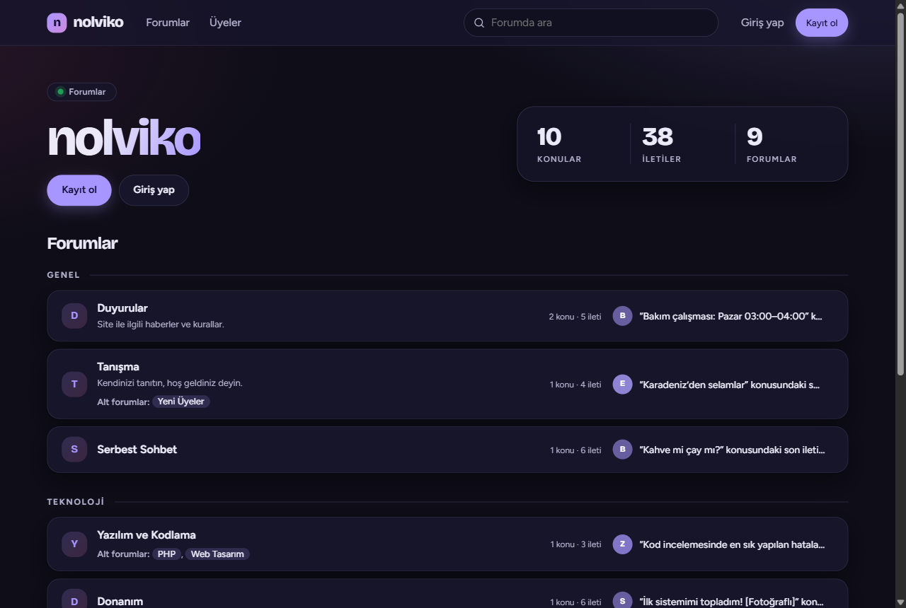
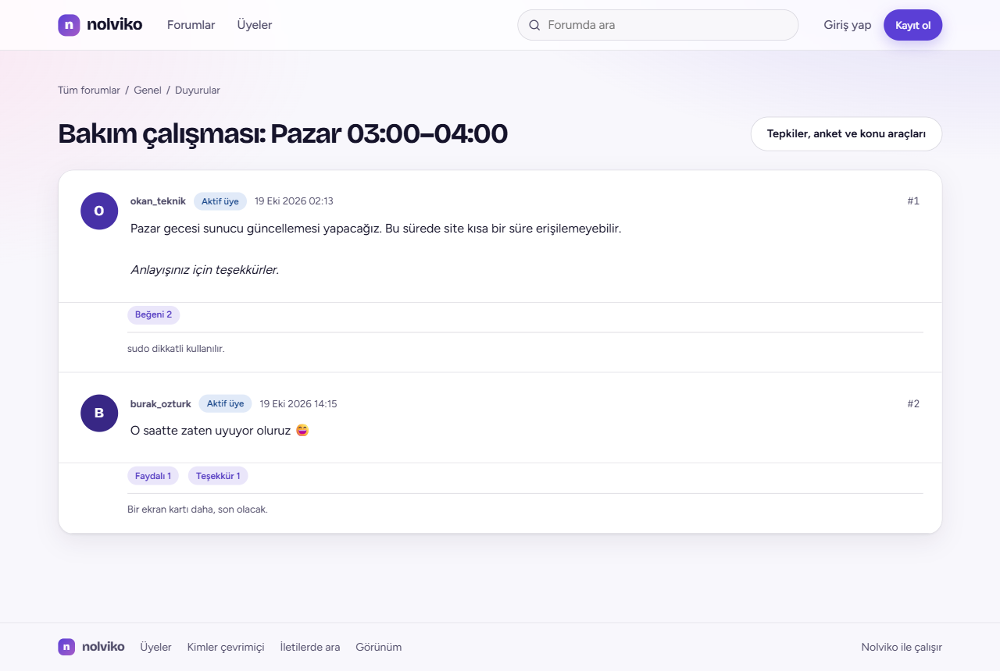
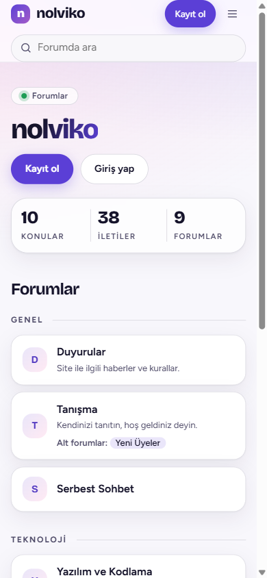

# Lumen — a Nolviko theme

A light, airy theme for [Nolviko](https://github.com/Nolviko/nolviko): soft colour glows, a frosted sticky header, pill-shaped controls,
forums as floating cards and a large home hero with the forum's totals. Light and dark mode, right-to-left
scripts, reduced motion and high-contrast mode are supported.

## Screenshots

| Light mode | Dark mode |
|---|---|
|  |  |

| Thread page | Mobile |
|---|---|
|  |  |

## Installation

1. Download the latest `nolviko-theme-lumen-<version>.zip` from this repository's **Releases** page.
2. In your forum: **Admin → Themes → Import**, choose the ZIP and confirm that you trust the package.
3. Build a draft, preview it, then publish. You can switch back to the default theme at any time.

Requires [Nolviko](https://github.com/Nolviko/nolviko) 0.1.0-beta.3 or newer (version 1.0.0 works with 0.1.0-beta.2).

## Development

A theme is a child of the `default` theme: `theme.json` (manifest), `tokens.json` (colours, radius, spacing,
font, density for light and dark mode; contrast is checked on build), `assets/*.css` and template overrides in
`views/`. Only these files go into the ZIP. Every override records the hash of the core template it replaces
(`upstream` in `theme.json`); when core changes that template, the build shows a warning and the theme needs an
update.

## License

[Apache License 2.0](LICENSE), like Nolviko itself.
